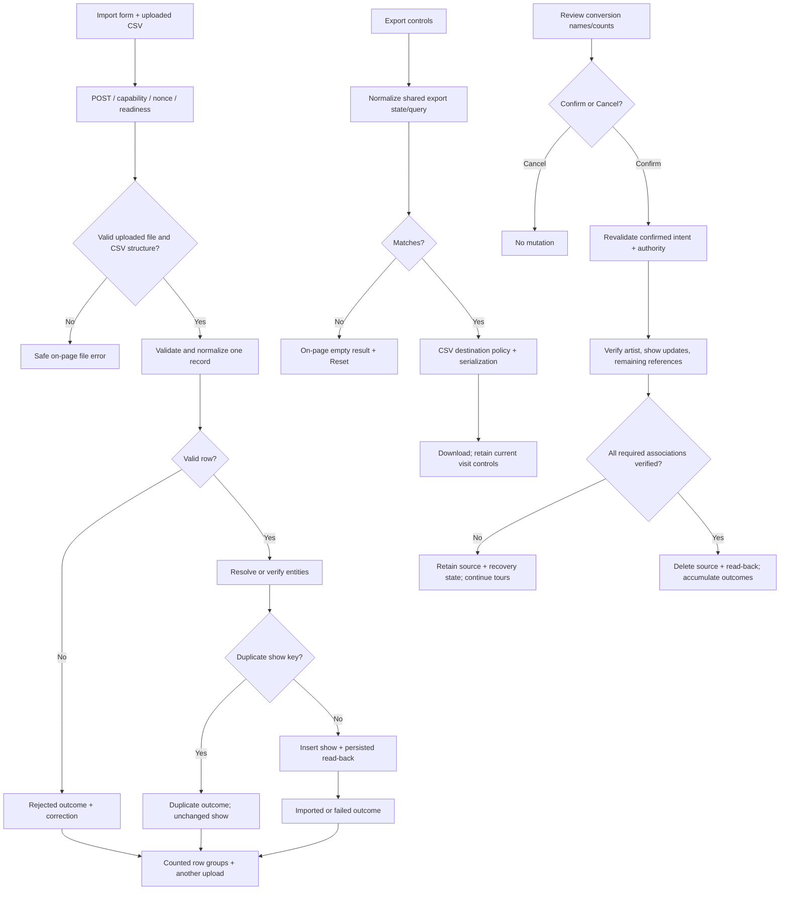

# Phase 05: CSV Import/Export - Research

**Researched:** 2026-10-11
**Domain:** Procedural WordPress/PHP CSV transfer, recoverable related-record writes, administration feedback.
**Confidence:** HIGH for current source contracts; MEDIUM for external spreadsheet guidance; the D-17 policy and remaining execution prerequisites are explicitly resolved/disposed below.

<user_constraints>
## User Constraints (from CONTEXT.md)

Source: the following locked decisions, discretion and deferred ideas are copied verbatim from the phase context. [VERIFIED: .planning/phases/05-csv-import-export/05-CONTEXT.md:22-56,134-136]

<!-- DATA_8f2c4a71_START -->
### Locked Decisions

### Import/export screen

- **D-01:** Keep both tasks on one page in stacked sections, Import first and Export below, both immediately visible. This follows the existing settings-page organization rather than adding tabs.
- **D-02:** Keep essential CSV requirements visible beside the upload control. Provide an expandable reference containing column names, formats and examples.
- **D-03:** Keep “Include related-post associations” as a visible checkbox, unchecked by default. Explain that related post IDs must match posts on the destination site. Preserve the existing option's intent rather than silently enabling associations.
- **D-04:** Use the action labels “Import shows” and “Download CSV,” making clear that importing saves records and exporting downloads a file.

### Import results and retry

- **D-05:** Show a summary with imported, duplicate, rejected and failed counts, plus expandable row details for each outcome group. Preserve the inherited skipped-row behavior while making its reasons clear; an existing skipped outcome must be counted truthfully in the appropriate group, not lost or counted twice.
- **D-06:** Rejected and failed details identify the CSV row number, show identity, affected field where applicable, and correction guidance. Example: “Row 8: invalid Date; use YYYY-MM-DD.” System failures need a truthful reason and an available next step rather than an invented field error.
- **D-07:** Stay on Import/Export after importing. Keep the result visible, offer a link to the show list and make another upload available.
- **D-08:** Recommend correcting the original CSV and uploading it again. Explain that existing matching shows are skipped as duplicates and are not overwritten. Safe retry must avoid duplicating completed shows or related records; characterize the established matching behavior before changing the importer.

### Export behavior

- **D-09:** Show the selected artist, tour and date-scope filters and matching show count beside “Download CSV.” Preserve all existing filters and their meanings. Example: “Upcoming shows · All artists · Summer Tour · 24 shows.” The summary/count must describe the actual export query.
- **D-10:** When no shows match, stay on the page, display “No shows match these export filters” and offer Reset filters. Produce no download. Reset returns to the existing all-artists/all-tours/all-dates defaults.
- **D-11:** Retain export choices for the current visit, including after downloads or errors. Later visits use the existing defaults. Do not add persistent per-user export preferences.
- **D-12:** Provide a short visible spreadsheet note plus expandable steps explaining how to import values as text and preserve them when editing for re-import. Retain the CSV transfer contract. The user chose guidance placement; they did not select a new spreadsheet-specific output mode or a transformation of exported values.

- **D-17:** Planning clarification, 2026-10-11: preserve exact exported values, including formula-like strings and legitimate leading-plus phone numbers, with explicit spreadsheet text-import guidance. The user accepted that direct opening can execute formulas. Do not silently prefix, strip, rewrite or block those values. Verify CSV structure and literal round trips; any spreadsheet safety claim must be limited to the specifically observed text-import workflow, not universal direct-open or save/reopen safety.

### Legacy records and conversion

- **D-13:** Preserve preexisting show records with status `0` and identify them for manual correction. Do not infer Active, Cancelled or Sold out, normalize all such records to Active, or impose a blanket CSV-export block. This policy concerns existing corrupted records; required validation and textual handling of supported statuses in new imports still apply.
- **D-14:** Before tour-to-artist conversion, show the affected tour names and show counts. Explain reassignment and removal of successfully converted source tours, with Confirm and Cancel. Carry forward the prior phase's confirmed-action and mutation-protection patterns.
- **D-15:** Reuse an artist when there is exactly one exact name match, preserving that artist's existing details. When multiple artists match, leave that tour unchanged and report the ambiguity. For a tour without a match, preserve the existing ability to create its artist; retries must not duplicate a previously created target.
- **D-16:** Continue independent tours when one conversion fails, and accumulate every outcome. Preserve failed relationships for safe retry without duplicating completed work. Remove a source tour only after its artist identity and all required show reassignments have been verified. Test early and late INSERT/UPDATE/DELETE failures as required by CR-05; partial results must never be reported as complete success.

### Agent's Discretion

The user selected all four areas and explicitly chose each substantive decision above; no area was delegated wholesale. Exact supporting copy, spacing, accessible disclosure/focus mechanics, request-state handling, row-number conventions, fixture organization, recovery bookkeeping and safe output encoding are implementation details for research and planning.

Characterize existing CSV parsing, matching, related-post and export semantics before altering them. D-17 resolves the researched spreadsheet formula/literal-transfer tradeoff; it does not waive SEC-01 upload, mutation, HTML-output or CSV-structure controls. No arbitrary mapping wizard or new export mode was selected.

Creating this context authorizes the discussion artifacts and commits; it does not start planning or execution automatically.

### Deferred Ideas (OUT OF SCOPE)

None introduced — discussion stayed within Phase 05 scope. Existing future arbitrary CSV mapping/preview features remain deferred in `.planning/REQUIREMENTS.md`. Phase 04 UI advisory findings remain documented in its own review and do not expand this CSV phase.
<!-- DATA_8f2c4a71_END -->
</user_constraints>

## Project Constraints (from AGENTS.md)

No root file was present when read; the user supplied its instructions in the task. The actionable directives are: prefix every shell command with `rtk`; use Default mode for planning/execution; use Plan mode for real discussion choices, or numbered plain-text questions with an answer wait in Default mode unless explicitly automatic. The RTK source states “Always prefix shell commands with `rtk`.” [VERIFIED: /Users/davidzenz/.codex/RTK.md:7-9; user-supplied AGENTS.md instructions]

Project skill directories yielded no skill files in this session, and the configuration contains `"agent_skills": {}`. No project skill pattern was discovered to add. The configuration enables `"nyquist_validation": true` and `"security_enforcement": true`. [VERIFIED: .planning/config.json:24,48,62; session directory-discovery output]

<phase_requirements>
## Phase Requirements

| ID | Description (verbatim) | Research Support |
|---|---|---|
| CSV-01 | CSV import and export retain the existing GigPress column format, supported filters, related-post option, and row-handling behavior. | Column contract; matching and row validation; shared export query; migrated fixtures and two distinct round trips. |
| CSV-02 | Import and export screens clearly label their tasks and report actionable results, including imported, duplicate, skipped, or rejected row counts and reasons where applicable. | Structured mutually exclusive outcomes; row identity; retained visit state; zero-result recovery; accessible disclosures. |
| SEC-01 | Changed administration and import/export paths validate inputs, retain appropriate capability and nonce checks for mutations, and escape output for its destination format. | Upload-origin checks; boundary validation; actual capability enforcement; verified writes; HTML versus CSV serialization; D-17 exact-literal policy and scoped client evidence. |

The IDs and descriptions above come from the requirement definitions. [VERIFIED: .planning/REQUIREMENTS.md:35-41]
</phase_requirements>

## Summary

Use the existing procedural plugin, bundled parser and real WordPress compatibility harness. Current plugin declarations are `Requires at least: 7.0`, `Requires PHP: 8.3`; the current database constant is `define('GIGPRESS_DB_VERSION', '1.6');`. This phase needs no schema/version change or external package install. The parser identifies itself as `Class: parseCSV v0.4.3 beta`. [VERIFIED: gigpress.php:10-11,43; lib/parsecsv.lib.php:7]

The highest-risk work is preserving identities during interrupted import/conversion, correcting textual status writes, and separating stored/parsed values from HTML notices. Import currently creates tour/artist/venue records before duplicate detection and checks only the eventual show insert; conversion unconditionally inserts, updates and deletes and evaluates only the last iteration. The reviewed source still contains these behaviors. [VERIFIED: admin/handlers.php:1016-1136,1225-1243]

**Primary recommendation:** First deliver a populated migrated-fixture tracer through protected import, verified row insertion, literal CSV export and safe repeat import. Establish structured outcomes and an exact harness registry in that slice. Then implement full input/retry coverage, export screen/query state and confirmed conversion in dependency order. Implement D-17 exactly: preserve formula-like and leading-plus values, provide text-import guidance, and keep any spreadsheet claim scoped to the named observed workflow without transforms or download blocking. [VERIFIED: tests/compat/public-tracer.php:47-83; admin/handlers.php:1084-1136; 05-CONTEXT.md D-17; CITED: https://community.owasp.org/attacks/CSV_Injection]

## Architectural Responsibility Map

The ownership below is the recommended design, grounded in the existing server-rendered import page, WordPress callback and database handlers. [VERIFIED: admin/import-export.php:3-98; gigpress.php:656-703; admin/handlers.php:993-1196,1225-1248]

| Capability | Primary Tier | Secondary Tier | Rationale |
|---|---|---|---|
| Labels, help, disclosures, retained controls | Frontend Server (WordPress admin PHP) | Browser enhancement | Render usable forms without JavaScript; optional focus/count enhancement must follow the same state. |
| Upload authorization and validation | API / Backend (admin callback) | WordPress upload API | Gate before reading/moving an upload or writing a record. |
| Row validation, identity lookup and retry | API / Backend | Database / Storage | Preserve duplicate key and resolve persisted identities, not browser assertions. |
| Tour conversion confirmation and recovery | API / Backend | Database / Storage | Bind confirmed intent; verify all writes before source deletion. |
| Export count, membership, serialization | API / Backend | Database / Storage | One normalized query defines both count and actual downloadable rows. |
| HTML feedback | Frontend Server | — | Escape raw row/file/system text at the final HTML sink. |
| Spreadsheet interpretation | External spreadsheet client | Backend detection / browser guidance | D-17 fixes exact literal transfer and scoped text-import guidance; CSV syntax still cannot support a universal client-safety claim. |

## Standard Stack

### Core

| Library/runtime | Version / provenance | Purpose | Planning direction |
|---|---|---|---|
| WordPress core | Minimum `Requires at least: 7.0`; supported lines are user-locked | Administration, capabilities, nonces, uploads, database APIs | Use core APIs; resolve supported patches once for final evidence. [VERIFIED: gigpress.php:10; 05-CONTEXT.md user constraints above] |
| PHP | Minimum `Requires PHP: 8.3` | Existing procedural callbacks | Execute PHP in official WordPress containers. [VERIFIED: gigpress.php:11; tests/compat/run.sh:1-3,193-200] |
| Bundled parseCSV | `Class: parseCSV v0.4.3 beta` | Existing parsing and serialization | Retain it; wrap narrow boundary checks and repair demonstrated parser defects only. [VERIFIED: lib/parsecsv.lib.php:7,193-207,511-538] |
| WordPress `$wpdb` | Host core version | Existing custom tables and field formats | Use prepared queries, strict failure checks and persisted-value read-back. [VERIFIED: admin/handlers.php:226-235; CITED: https://developer.wordpress.org/reference/classes/wpdb/insert/] |

### Supporting

| Tool | Existing version / configuration | Purpose |
|---|---|---|
| Docker / Compose through OrbStack | CLI `29.4.0`, Compose `v5.1.2` observed | Disposable real WordPress/PHP cells. [VERIFIED: session version-probe output] |
| MariaDB | `image: mariadb:11.4.5` | Harness database. [VERIFIED: tests/compat/compose.yaml:1-15] |
| Bash, jq, Node, Python | Node `v26.10.0`, jq `jq-1.7.1-apple`, Python `3.14.8` observed | Existing harness routing, aggregation, fingerprints; not production dependencies. [VERIFIED: session version-probe output; tests/compat/run.sh:654-730] |

**Installation:** No new production packages. Retain bundled code and core APIs. Registry-version checks and a package legitimacy audit are not applicable to this no-install phase. Do not use an unrelated latest parseCSV package as a substitute for the repository's bundled API. [VERIFIED: lib/parsecsv.lib.php:7,193-207; locked procedural/bundled-parser scope in task]

The pre-modernization stack map claims older support and absent testing; current declarations and harness supersede those descriptions. Its literal historical claims include “WordPress 3.0+ API” and “Testing: Not detected.” [VERIFIED: .planning/codebase/STACK.md:29-35; gigpress.php:10-11; tests/compat/run.sh:509-583]

## CSV Contract and Current Behavior

### All 23 columns, in established export order

The source defines the complete header verbatim:

<!-- DATA_c191a4b8_START -->
```php
"Date", "Time", "End date", "Artist", "Artist URL", "Venue", "Address", "City", "State", "Postal code", "Country", "Venue phone", "Venue URL", "Admittance", "Price", "Ticket URL", "Ticket phone", "External URL", "Notes", "Tour", "Status", "Related ID", "Related URL"
```
<!-- DATA_c191a4b8_END -->

[VERIFIED: gigpress.php:680-682]

The following field mappings are the existing query/insert contract, not a new schema. [VERIFIED: gigpress.php:684-698; admin/handlers.php:1044-1075,1104-1125]

| # | CSV column | Export/import meaning |
|---|---|---|
| 1 | Date | Stored start date. |
| 2 | Time | Stored time; unspecified-time output is empty. |
| 3 | End date | Stored expiration; output empty when equal to start; blank import sets expiration to start and multi-day flag off. |
| 4 | Artist | Name-based artist identity. |
| 5 | Artist URL | Used only when creating an artist; matched artist details remain intact. |
| 6 | Venue | Venue-name component of identity. |
| 7 | Address | Used only when creating venue. |
| 8 | City | Venue-city component of identity. |
| 9 | State | Used only when creating venue. |
| 10 | Postal code | Text; do not numeric-cast leading zeros. |
| 11 | Country | Venue-country component of identity; existing schema is `venue_country VARCHAR(2) NOT NULL,`. [VERIFIED: admin/db.php:60] |
| 12 | Venue phone | Text; signs/leading zeros matter. |
| 13 | Venue URL | Used only when creating venue. |
| 14 | Admittance | Show admission text. |
| 15 | Price | Show price text, not a new numeric price model. |
| 16 | Ticket URL | Show ticket destination. |
| 17 | Ticket phone | Show ticket-phone text. |
| 18 | External URL | Show external-link value. |
| 19 | Notes | Show notes; existing permitted-rich-content normalization applies. |
| 20 | Tour | Optional active-tour name match/create. |
| 21 | Status | Textual supported status on new imports; empty defaults to active. |
| 22 | Related ID | Existing destination-site post association only when opted in. |
| 23 | Related URL | Derived export convenience value; not used to fetch/create/link a post on import. |

Do not imply CSV carries show IDs, entity IDs, artist order, independent multi-day flags, or arbitrary expiration-only semantics. The existing header above does not include those values; rows export expiration and importer infers the multi-day flag from whether End date is supplied. On the same-site retry, original identities must remain; a new destination allocates its own show/entity IDs. The legacy export also blanks equal start/end dates, so a same-day multi flag cannot be represented independently. [VERIFIED: gigpress.php:680-698; admin/handlers.php:1098-1120]

### Header, parser, encoding and upload

- The defaults are `var $heading = true;`, `var $delimiter = ',';`, `var $enclosure = '"';`, `var $convert_encoding = false;`, `var $input_encoding = 'ISO-8859-1';`, `var $output_encoding = 'ISO-8859-1';`, `var $linefeed = "\r\n";`. The import calls `parse`, not delimiter autodetection or encoding conversion. The nominal encoding defaults therefore do not constitute transcoding. [VERIFIED: lib/parsecsv.lib.php:87-132; admin/handlers.php:1008-1009]
- The first record becomes header keys; matching is case-sensitive PHP array access. Unquoted fields are trimmed, quoted fields retain their contents; enclosed separators/newlines and doubled quotes have explicit parser branches. Duplicate header names overwrite the same associative key. Short rows leave missing keys; additional columns can receive numeric keys. The handler currently does not validate this structure before looking up columns. [VERIFIED: lib/parsecsv.lib.php:390-475; admin/handlers.php:1016-1019,1059-1061]
- The file loader appends a newline when absent using `if ( substr($data, -1) != "\n" ) $data .= "\n";`. The read loader inspected here does not normalize a BOM, and parser headers are assembled directly from bytes. A leading UTF-8 BOM is therefore a specific header-recognition edge to characterize; accept a UTF-8 BOM only at the beginning as syntax metadata, without changing cell values. Do not silently guess UTF-16/legacy encoding or switch to semicolon/tab autodetection. [VERIFIED: lib/parsecsv.lib.php:550-563,378-379,445-456]
- Parser error values are verbatim `var $error = 0;`, `$this->error = 2;`, `$this->error = 1;`. Parsing can return rows with error information; import currently checks only `$csv->data`. Plan negative cases for malformed/unclosed quotes, delimiter-only/blank records, duplicate/missing headers and short/long records. Check the lookahead `$data[$x]` at quote/end-of-input under E_ALL; source inspection identifies an unchecked access requiring characterization, not a claimed runtime failure. [VERIFIED: lib/parsecsv.lib.php:159,397-407,414-435; admin/handlers.php:1011]
- Current upload code is verbatim `$upload = wp_upload_bits( $_FILES['gp_import']['name'], null, file_get_contents($_FILES['gp_import']['tmp_name']) );`; it reads a submitted path before checking PHP upload origin, shape/error/size. It unlinks the copied file on the ordinary success path and emits the raw original filename/error on upload failure. Replace the unsafe boundary, preserving short-lived import processing and cleanup. [VERIFIED: admin/handlers.php:1000-1003,1188-1193]
- Recommendation: validate POST action/capability/nonce/readiness first; validate single-file structure, PHP upload error, actual uploaded origin, permitted extension/type, readable bounded bytes and content/header contract before any entity write. Parse the validated PHP upload temporary file directly and avoid publicly copying it merely to read it. If core upload handling is used, call the public wrapper with normal uploaded-file checks, restricted CSV types and guaranteed cleanup. Core size checking alone checks nonempty content, so an application processing bound needs an explicit decision/calculation. [CITED: https://developer.wordpress.org/reference/functions/wp_handle_upload/; https://developer.wordpress.org/reference/functions/_wp_handle_upload/; https://www.php.net/manual/en/features.file-upload.post-method.php]

### Entity matching, duplicate behavior and safe retry

Existing lookup predicates are verbatim:

<!-- DATA_74d2e06f_START -->
```sql
WHERE artist_name = '%s'
WHERE tour_name = '%s' AND tour_status = 'active'
WHERE venue_name = '%s' AND venue_city = '%s' AND venue_country = '%s'
WHERE show_artist_id = '%d' AND show_date = '%s' AND show_time = '%s' AND show_venue_id = '%d' AND show_status != 'deleted'
```
<!-- DATA_74d2e06f_END -->

[VERIFIED: admin/handlers.php:1018-1025,1059-1061,1086-1094]

Artist is matched by name; tour by active name; venue by name/city/country. A duplicate show is matched by artist/date/time/venue, irrespective of changed tour, notes, price or non-deleted status; it is skipped, never overwritten. A matching trashed show does not suppress a new import. Existing related-entity details are not replaced with the incoming row. SQL equality follows the database collation; this is not proof of byte-exact name matching. The current single-result lookups have no explicit ambiguity resolution. Preserve established CSV matching membership while making unsafe ambiguity/system failures truthful; conversion's D-15 explicitly requires exactly one exact name match. [VERIFIED: admin/handlers.php:1018-1096,1041-1053,1062-1079]

Normalize into the values intended for storage before validating required identity fields or searching again on retry. Existing helper behavior is verbatim `$value = stripslashes(trim($value));`, followed by `sanitize_text_field($value, TRUE)` or `wp_kses_post($value)`. Matching raw CSV names while storing normalized names can create another entity after failure, especially with tags/whitespace/backslashes. CSV file bytes are not WordPress request-slash data. Characterize these differences with independent expected values, and keep normalization localized to CSV rather than changing the shared helper relied on by accepted administration/public work. Preserve valid stored text and permitted note markup; do not blindly HTML-escape before storing/exporting. [VERIFIED: gigpress.php:485-499; admin/handlers.php:1018-1075; .planning/phases/04-public-publishing/04-VERIFICATION.md:92-96]

Validate the complete row before creating entities. For each needed entity: resolve the compatible existing identity; create only if absent; require a successful insert and persisted identity read-back; never consume a stale `$wpdb->insert_id`. Recheck the duplicate key before show insertion. If an entity was created but a later operation fails, reuse its verified identity on retry; do not delete an entity shared with another completed row. Distinguish failure to query from a verified empty lookup. Existing show-save code already checks a write against actual persisted field values and carries completed related IDs into recovery. [VERIFIED: admin/handlers.php:56-63,217-235]

### Date, time, status and related-post meanings

- The existing optional-time assignment is `if($show['Time'] == FALSE) $show['Time'] = '00:00:01';`; export uses `$show['show_time'][7] == 1` to emit empty time, while administration writes `'00:00:01'` for unspecified and `sprintf('%02d:%02d:00', ...)` for a selected time. Explicit midnight must stay distinct. Validate real clock values and retain established blank/sentinel meaning. Export's character test is broader than strict sentinel equality, so unusual legacy seconds must be characterized and surfaced without silently rewriting stored values. [VERIFIED: admin/handlers.php:1084,131; gigpress.php:691]
- Existing date validation checks `\A([0-9]{4})-([0-9]{2})-([0-9]{2})\z` and `checkdate`. Reuse it for CSV calendar dates; blank End date means one date, while supplied End date drives the multi-day flag. Preserve expiration-based scope. An unrelated empty/invalid value must not be converted into a guessed date. [VERIFIED: admin/handlers.php:37-40,1098-1108]
- Supported status values are verbatim `array('active', 'soldout', 'cancelled')`; existing default is `'active'`. Current show insertion has the field `'show_status' => (!empty($show['Status'])) ? gigpress_db_in($show['Status']) : 'active',` but formats `array('%s','%s','%d','%s','%d','%d','%d','%s','%s','%s','%s','%s', '%s', '%d', '%d');`. The fourteenth field is textual status but format fourteen is integer. Build formats from a field-to-format definition and align them with actual data order; changing an associative format array alone does not magically key WordPress's format processing. Use textual status, integer association fields, strict status validation, and exact read-back. [VERIFIED: admin/handlers.php:96,1104-1129; CITED: https://developer.wordpress.org/reference/classes/wpdb/insert/]
- D-13 settles existing status `0`: preserve and identify manual correction; export it unchanged rather than inventing a supported status or blocking all export. New rows with unsupported status must be rejected with an explicit Status reason. Document that such a legacy row requires manual status correction before becoming a valid new import, even though its export is allowed. Same-site retry assertions must not silently change any existing status. [VERIFIED: 05-CONTEXT.md user constraints above; admin/handlers.php:96]
- Current checkbox condition is verbatim `if(isset($_POST['include_related']) && $_POST['include_related'] = 'y')`: assignment makes any present value opt in. Require the exact intended scalar value `'y'`; unchecked leaves `'show_related' => '0'`. When opted in, validate the Related ID as an existing permitted destination post reference; use core authorization for that association and distinguish nonexistent/unavailable posts. Related URL remains informational and must not trigger network lookup, matching, post creation or overwriting. [VERIFIED: admin/handlers.php:1119,1122-1125; gigpress.php:693; admin/import-export.php:27; CITED: https://developer.wordpress.org/reference/functions/current_user_can/]

### Export query and serialization

Filters use `'-1'` for all, with scopes `'upcoming'` and `'past'`. Query predicates are `show_expire >=` and `show_expire <` against `GIGPRESS_NOW`, whose definition is `gmdate( 'Y-m-d', ( time() + ( -11 * HOUR_IN_SECONDS ) ) )`. Export excludes `show_status != 'deleted'`, requires artist/venue joins, left-joins tours and orders `ORDER BY show_date DESC,show_time DESC`. Do not replace this with the show-list query: that query has different filters/order. Count must include precisely this membership, including its join effects, and the download must recompute authoritatively. [VERIFIED: admin/import-export.php:56-87; gigpress.php:47,663-685]

Serializer calls `output($name, stripslashes_deep($export_shows), $fields, ',');`, emits `Content-type: application/csv`, attachment disposition and CRLF records. It iterates each row's insertion order rather than selecting fields by header name. CSV quote escaping belongs here; HTML escaping would corrupt literals. Guard typed conversion/array order, derived Related URL placement, quotes/commas/newlines, Unicode, numeric-looking text and backslashes with independently parsed output assertions. Preserve established sanitization/storage semantics while documenting any double-stripslash loss found by characterization. [VERIFIED: gigpress.php:693-698; lib/parsecsv.lib.php:233-240,511-537,679-688]

## Architecture Patterns

### System Architecture Diagram

Proposed flow grounded in the existing routes and the required confirmation/outcome boundaries. [VERIFIED: admin/import-export.php:21-38,50-53; admin/artists.php:23-26; admin/handlers.php:993-1196,1225-1248]



### Component Responsibilities / Recommended Project Structure

Keep existing production files; proposed test modules are additions, not observed existing paths. No new framework or schema is needed. [VERIFIED: gigpress.php:60-67; admin/import-export.php:3; admin/handlers.php:993,1225; tests/compat/run.sh:509-583]

| Component | Ownership / change |
|---|---|
| Existing import/export screen | Stacked tasks; labelled upload; visible essential rules; column/help disclosures; result renderer; visit state and shared count. |
| Existing import handler | Boundary validation; complete-row validation; identity/read-back; duplicate key; mutually exclusive outcomes; cleanup. |
| Existing export callback | Protected route; normalized state; shared selection/count query; exact CSV data projection; no-result return. |
| Existing artist screen / conversion handler | Safe read-only review; POST Confirm/Cancel; bound intent; per-tour outcomes and durable recovery. |
| Existing admin CSS / script | Remove the current opposing floats (`width: 48%; float: left;` / `float: right;`); scope disclosure/focus behavior to CSV. [VERIFIED: css/gigpress-admin.css:182-190] |
| Proposed CSV registry + case modules | One harness integrator owns scenario routing/evidence; separate files for tracer/migrated/import/export/conversion assertions. |

### Pattern 1: One outcome per CSV record

Create a structured result rather than echoing from each mutation branch. Each parsed data record ends in exactly one of the user-required groups; inherited database-related skips become failed outcomes, malformed row inputs become rejected, existing matches become duplicate, verified show writes become imported. Report an input-file failure separately from row counts. The existing handler already accumulates `$inserted`, `$skipped`, `$duplicates`; the defect is unvalidated/unverified classification and unsafe rendering. [VERIFIED: admin/handlers.php:1014,1095-1096,1131-1150,1155-1193]

Recommend CSV record numbers with the header numbered 1, making the first data record 2; label them as CSV rows, not physical text lines when quoted notes span newlines. The parser counts records and emits error rows from `count($rows) + 1`, so its syntax-error numbering cannot simply be reused as physical file lines. Keep original record identity attached through validation/matching. [VERIFIED: lib/parsecsv.lib.php:398-406,423-434,453-474]

### Pattern 2: One export state and membership function

Define a strict server-side state normalizer for the existing all/entity/scope choices. Use the resulting membership definition for selected labels/count, download and empty-state return. Keep controls in the currently loaded page during successful downloads; pass validated request state on empty/error return, using a visit-scoped token if needed to avoid between-visit preference semantics. Make the count available after selection with a normal server round trip, optionally enhanced by JavaScript. Never present a stale default count as the selected-filter count. [VERIFIED: gigpress.php:663-698; D-09–D-11 user constraints above]

### Pattern 3: Verified tour conversion with durable retry

The existing conversion selects active tours and updates all linked shows, without excluding trashed shows; it clears each tour association while assigning the artist. Its verbatim operations are `$wpdb->insert(GIGPRESS_ARTISTS, array('artist_name' => $tour->tour_name));`, `$wpdb->update(GIGPRESS_SHOWS, array('show_artist_id' => $wpdb->insert_id, 'show_tour_id' => 0), array('show_tour_id' => $tour->tour_id));`, then source DELETE. Keep that intended scope, but verify each required relationship and include all referenced shows in preview counts. [VERIFIED: admin/handlers.php:1231-1236]

Recommendation: snapshot the confirmed tour IDs/names/show IDs and intended original relationships; bind owner/expiry and reject a stale changed selection before writes. Reuse the prior owner-bound confirmed-action pattern, with a conversion-specific intent. For exact matching, compare actual persisted names exactly rather than treating a collation-equivalent SQL result as sufficient. Exactly one match preserves existing details; several matches leave the tour unchanged. Newly created artists need the normal required artist fields, then verified identity. [VERIFIED: admin/handlers.php:428-476,1043-1049; admin/db.php:44-51; D-14–D-16 user constraints above]

Use a small durable operation journal in WordPress options, not a new table/schema, recording verified target identity and original per-show associations before destructive work. This is an implementation recommendation within recovery bookkeeping discretion, not an existing option contract. Verify journal persistence before relying on it; it survives request failure unlike only local variables/transients. For a partly updated tour, retry should resume/verify owned completed changes and remaining associations without overwriting a later deliberate reassignment. Retain failed source tours. Delete only when all required show IDs point at the verified artist with cleared tour association, no remaining show references the source, and source deletion read-back confirms removal. A zero-row update on a tour with no shows is not inherently failure; judge intended state. Continue independent tours and aggregate every result. [VERIFIED: admin/handlers.php:971-979,1233-1243; .planning/CSV-REVIEW-FOLLOWUPS.md:8-10]

Do not make atomic rollback the only safety strategy: the existing schema does not explicitly declare an engine and live installations were not inspected. Engine-specific transaction guarantees are unconfirmed. A verified recovery journal/read-back works with the preservation boundary without guessing engine support. [ASSUMED: transaction availability on existing installations is unobserved; admin/db.php:17-70 inspected]

### Tracer-first dependency and parallel ownership plan

1. First slice owns shared CSV helper/outcome contracts, importer status/read-back, one migrated trace, scenario plumbing and an independently asserted repeated round trip.
2. Establish normalized export query/state and input contracts before screen work depends on them.
3. After those seams stabilize, export screen/serialization and conversion can run independently only with explicit nonoverlapping ownership. Assign one integrator to the shared handler and harness routing files; conversion may land in an included procedural module rather than competing edits to the same large handler.
4. A final integration owner adds all-required-case aggregation, pinned support evidence and the retained browser fixture. Close actual keyboard/disclosure/download/retry acceptance separately.

This sequencing follows the existing harness's explicit nonempty case contracts and shared source hotspots. [VERIFIED: tests/compat/probe.php:41-93; tests/compat/run.sh:546-577,1691-1722; admin/handlers.php:993-1248]

### Anti-Patterns to Avoid

- Treating the upload nonce as authority: core explicitly requires capability authorization separately. [CITED: https://developer.wordpress.org/apis/security/nonces/]
- Turning invalid headers/dates/status into silent defaults after related writes; the current handler shows why validation must come first. [VERIFIED: admin/handlers.php:1016-1129]
- Marking successful SQL execution as a verified final relationship, or using only the last tour variables as batch success. [VERIFIED: admin/handlers.php:1233-1241]
- Using a generic HTML helper on CSV data or typography as HTML protection. CSV serializer and imported notice sinks have different semantics. [VERIFIED: admin/handlers.php:1159,1168,1177; lib/parsecsv.lib.php:679-688; CITED: https://developer.wordpress.org/apis/security/escaping/]
- Calling current fresh-workflow checks proof of populated migrated CSV behavior. The prior verifier explicitly deferred that integration. [VERIFIED: .planning/phases/02-data-and-upgrade-preservation/02-VERIFICATION.md:33-36; tests/compat/probe.php:803-867]

## Don't Hand-Roll

| Problem | Don't Build | Use Instead | Reason |
|---|---|---|---|
| CSV quote/delimiter handling | String splitting / ad hoc quoting | Existing parser/serializer plus characterization tests | Its current enclosure/newline rules are part of compatibility. [VERIFIED: lib/parsecsv.lib.php:390-475,511-538] |
| Administration identity/CSRF | Custom cookies / nonce substitutes | WordPress capability and nonce APIs | Nonces and permissions are distinct. [CITED: https://developer.wordpress.org/apis/security/nonces/] |
| HTML feedback protection | Regex tag stripping at render time | Destination-specific core escaping | Escape late for HTML text, attributes and URLs. [CITED: https://developer.wordpress.org/apis/security/escaping/] |
| Date recognition | `strtotime` guessing | Existing strict calendar-date helper | Retains a defined calendar format. [VERIFIED: admin/handlers.php:37-40] |
| Compatibility scaffolding | New PHPUnit/mock database framework | Existing real WordPress/Compose cases | Current runner already isolates and checks real writes. [VERIFIED: tests/compat/run.sh:1636-1676; tests/compat/probe.php:41-93] |
| Conversion as new product | General data-repair interface | Existing artist route with confirmed operation and recovery bookkeeping | Repairs the required inherited conversion within scope. [VERIFIED: admin/artists.php:23-26; D-14–D-16 user constraints above] |

## Runtime State Inventory

Included because tour-to-artist conversion migrates live associations even though this phase does not rename code or change schema.

| Category | Items Found / Evidence Boundary | Action Required |
|---|---|---|
| Stored data | Existing custom artist/tour/show tables; source conversion changes artist/tour references, including trashed shows. Settings/schema must stay intact. Table suffixes are verbatim `'gigpress_shows'`, `'gigpress_tours'`, `'gigpress_artists'`, `'gigpress_venues'`, prefixed by `$wpdb->prefix`. [VERIFIED: gigpress.php:38-41; admin/handlers.php:1231-1236] | Verified per-tour data mutation and retry journal; no version bump, no mass status repair. |
| Live service config | No live-site/service dataset supplied; only plugin and reconstructed fixture configuration was read. External service state was not audited. [ASSUMED] | No proposed external configuration mutation; obtain live evidence only if execution introduces such a dependency. |
| OS-registered state | No rename/rebrand or OS registration is part of the phase; no host registration audit was performed. [ASSUMED] | No registration action planned. |
| Secrets/env vars | Harness uses existing runner-owned database/fixture credentials; no secret-value output or rename needed. Verbatim injected variable names include `COMPAT_DB_PASSWORD`, `COMPAT_DB_ROOT_PASSWORD`, `WORDPRESS_IMAGE`. [VERIFIED: tests/compat/compose.yaml:7-8,18,26; tests/compat/run.sh:1637-1638] | Preserve owned ephemeral fixture handling. |
| Build artifacts / installed packages | Production is bundled PHP; this phase proposes no package installation. The harness creates its result directory via `RESULT_DIR="$COMPAT_DIR/.results"` and `mkdir -p "$RESULT_DIR"`. [VERIFIED: tests/compat/run.sh:7-9; gigpress.php:60-67] | Add phase-specific evidence without claiming existing reports certify changed CSV source; clean only owned fixture artifacts. |

## Common Pitfalls

### 1. Entity retries differ from show duplicates

**What goes wrong:** A show INSERT fails after an artist/tour/venue insert; a retry resolves raw rather than normalized name and creates another entity. Existing import performs these writes before duplicate checking and does not verify entity insert results. **Avoid:** validate first, use compatible normalized lookup, read back identities, persist/reuse completed work and assert unchanged existing entity details. **Warning signs:** extra entity count after a repeat, zero/stale IDs, partial row failures reported as field rejection. [VERIFIED: admin/handlers.php:1018-1096,1129-1150; gigpress.php:485-493]

### 2. Status fixes drift from adjacent formats

**What goes wrong:** Fixing an array index leaves another value misformatted when fields move. **Avoid:** align formats from field names in actual row order and assert all stored fields/relationships for every supported status. Include blank status default and preserved legacy zero separately. **Warning signs:** imported supported status reads `'0'`, wrong post ID, or duplicate retry unexpectedly changes records. [VERIFIED: admin/handlers.php:1104-1129; .planning/CSV-REVIEW-FOLLOWUPS.md:10]

### 3. Conversion success hides partial loss

**What goes wrong:** An early failure is hidden by a later successful tour; DELETE removes a tour still referenced by shows. **Avoid:** per-tour state, strict false checks, read-back of every intended reassignment, remaining-reference check, deletion read-back, durable recovery and full-batch outcomes. **Warning signs:** a success notice while failed relationships remain, duplicate target artist on retry, source absent with lingering show references. [VERIFIED: admin/handlers.php:1233-1241; .planning/CSV-REVIEW-FOLLOWUPS.md:9]

### 4. Upload tests bypass the secure upload boundary

**What goes wrong:** Existing CLI tests fabricate `$_FILES` with a local fixture `tmp_name`; adding actual uploaded-origin enforcement breaks them. **Avoid:** real multipart HTTP cases for the boundary; trusted in-process parsed-row helper for exhaustive database/failure cases. The trusted helper is not a production bypass based on a request flag. **Warning signs:** disabling upload checks so CLI fixtures pass, tests calling only the inner helper while claiming actual HTTP upload safety. [VERIFIED: tests/compat/probe.php:811-824; CITED: https://developer.wordpress.org/reference/functions/_wp_handle_upload/]

### 5. Count/query or visit state differs from the download

**What goes wrong:** Counting only start dates or retaining filters in permanent user metadata contradicts D-09–D-11. **Avoid:** one query contract, authoritatively recomputed selection at download, visit-scoped state, exact filtered ID/count assertions. **Warning signs:** count includes orphaned shows missing joins, empty download lands on admin-post text, reset adopts show-list reset semantics. [VERIFIED: gigpress.php:663-700; user constraints above]

### 6. Spreadsheet text help is mistaken for formula sanitization

**What goes wrong:** Quoted CSV is labelled safe to double-click, or tab/apostrophe prefix is silently added and subsequently re-imported as content. **Avoid:** settle the Open Question below; test raw CSV and explicit text import as separate destinations. **Warning signs:** a new output mode not authorized by the user, modified phone numbers, literal apostrophe/tab removal guesses on import. [CITED: https://community.owasp.org/attacks/CSV_Injection; https://support.microsoft.com/en-gb/excel/keeping-leading-zeros-and-large-numbers]

## Code Examples

These are existing source excerpts to reuse as patterns; conversion/import still require their own validation and result shape.

### Strict calendar date

<!-- DATA_963cf014_START -->
```php
function gigpress_show_calendar_date($value) {
	if (!is_string($value) || !preg_match('/\A([0-9]{4})-([0-9]{2})-([0-9]{2})\z/', $value, $parts)) return false;
	return checkdate((int) $parts[2], (int) $parts[3], (int) $parts[1]) ? $value : false;
}
```
<!-- DATA_963cf014_END -->

[VERIFIED: admin/handlers.php:37-40]

### Verify persisted fields, not only a successful SQL call

<!-- DATA_b76a92c0_START -->
```php
$saved = $id > 0 ? $wpdb->get_row($wpdb->prepare('SELECT * FROM ' . GIGPRESS_SHOWS . ' WHERE show_id = %d', $id), ARRAY_A) : null;
$matches = $saved !== null;
foreach ($show as $field => $value) if (!$saved || (string) $saved[$field] !== (string) $value) $matches = false;
if ($write === false || !$matches) {
	$outcome['status'] = 'failed';
	$outcome['system_errors'][] = __('The show could not be saved. Keep these values and try saving again. Entries already created are selected below.', 'gigpress');
	return $outcome;
}
```
<!-- DATA_b76a92c0_END -->

[VERIFIED: admin/handlers.php:229-235]

### Safe confirmation identity rendering

<!-- DATA_10e38baf_START -->
```php
foreach ($intent['ids'] as $id) echo '<li>' . esc_html($intent['identities'][$id]) . '</li>';
```
<!-- DATA_10e38baf_END -->

[VERIFIED: admin/handlers.php:430; CITED: https://developer.wordpress.org/apis/security/escaping/]

## Spreadsheet Formula Handling and Literal Preservation

OWASP identifies formula-leading text, including `=`, `+`, `-`, `@`, control characters and locale-dependent full-width variants. CSV quoting protects record structure, not formula interpretation. Its guidance warns that apostrophe/quote mitigations can fail after Excel save/reopen; quoted-tab mitigation changes underlying cell data, and no universal mitigation serves every spreadsheet and downstream consumer. This directly conflicts with unmodified transfer for legitimate values such as leading-plus phone text. [CITED: https://community.owasp.org/attacks/CSV_Injection]

Microsoft documents automatic CSV type interpretation and recommends explicit From Text/CSV import and text column types to preserve leading zeros/large numeric-looking values. This supports D-12 instructions but does not prove all clients or subsequent save/reopen cycles are protected from formulas. Keep raw file round-trip assertions distinct from manual spreadsheet acceptance. [CITED: https://support.microsoft.com/en-us/excel/get-started/import-or-export-text-txt-or-csv-files; https://support.microsoft.com/en-gb/excel/keeping-leading-zeros-and-large-numbers]

The existing serializer quotes separators/quotes/newlines/spaces and preserves quoted contents when parsing; it has no formula-specific output transform. Prefixing an exported cell would therefore change values read by this importer. The existing canonical fixture already includes `+1-555-0100` and `+1-555-0101`, so broad leading-plus rejection/rewriting affects an established fixture. [VERIFIED: lib/parsecsv.lib.php:445-447,679-688; tests/compat/fixtures/shows.csv:2]

**Planning decision resolved by user:** On 2026-10-11 the user chose exact literal transfer with explicit text-import guidance (D-17 in CONTEXT.md). Plan option A below, retaining all SEC-01 upload, mutation, HTML-output and CSV-structure controls. No universal spreadsheet-safety claim, silent transformations or formula-based download block. [VERIFIED: user reply recorded in 05-CONTEXT.md and 05-DISCUSSION-LOG.md]

## State of the Art

| Existing approach | Required phase approach | Why |
|---|---|---|
| Raw imported outcome text through typography | HTML text encoding at every notice sink | Required inherited CR-04. [VERIFIED: .planning/CSV-REVIEW-FOLLOWUPS.md:8] |
| Positional integer status | Validated text status and order-aligned formats | Required inherited CR-07. [VERIFIED: admin/handlers.php:1127; .planning/CSV-REVIEW-FOLLOWUPS.md:10] |
| Unconditional conversion + last-result success | Confirmed intent, verified relationships and per-tour retry outcomes | Required inherited CR-05 and D-14–D-16. [VERIFIED: .planning/CSV-REVIEW-FOLLOWUPS.md:9; user constraints above] |
| Historical generic CSV download help | Explicit text import/preservation instructions + policy decision | Current primary sources describe type conversion/formula risks; no new export mode chosen. [CITED: https://support.microsoft.com/en-us/excel/get-started/import-or-export-text-txt-or-csv-files; https://community.owasp.org/attacks/CSV_Injection] |

Do not describe the bundled parser as universally current or fully conformant merely because its old header claims that. Its supported behavior must be demonstrated by this repository's source and compatibility evidence. [VERIFIED: lib/parsecsv.lib.php:7-12]

## Assumptions Log

| # | Claim / uncertainty | Section | Risk if Wrong |
|---|---|---|---|
| A1 | Transaction availability on existing installations is unobserved; an unspecified schema engine does not prove either support or incompatibility. | Conversion | A rollback-only plan could lose recovery guarantees. |
| A2 | Live external service configuration was not audited. | Runtime State Inventory | External dependency would require actual inspection if newly introduced. |
| A3 | Host OS registrations were not audited; no registration operation is proposed. | Runtime State Inventory | A newly introduced host dependency would require inventory. |
| A4 | No measured application upload processing bound or real spreadsheet client/version acceptance has been obtained. | Resolved dispositions below | Use the request-time WordPress/PHP bound and exact UTF-8/BOM rule; keep any unobserved client workflow pending rather than inventing a guarantee. |

Design recommendations are explicitly recommendations within discretion; they are not assertions that helpers, journals or new harness cases already exist.

## Open Questions — RESOLVED

1. **Formula protection versus unchanged literal transfer — resolved by D-17.**
   - Resolution: preserve exact exported values, including formula-like strings and legitimate leading-plus phone numbers, provide explicit text-import guidance, and limit any client-safety statement to the specifically observed workflow. Direct-opening formula execution is an accepted destination limitation; no prefix, strip, rewrite, block, second output mode or universal claim is authorized. The binding D-17 wording remains verbatim in `User Constraints` above. [VERIFIED: 05-CONTEXT.md D-17 and 05-DISCUSSION-LOG.md]
2. **Upload processing bound and accepted encoding detail — resolved by implementation discretion.**
   - Resolution: resolve `wp_max_upload_size()` in the request-handling runtime and use that value as the application processing maximum; require both the submitted size and actual temporary-file byte length to be nonzero and no greater than that effective WordPress/PHP limit. Add no unrelated fixed numeric cap. Accept valid UTF-8 only, strip exactly one UTF-8 BOM only at byte zero before the first `Date` header, and reject invalid UTF-8, UTF-16/legacy encodings, a BOM elsewhere, normalization and silent transcoding. Surface the runtime-resolved byte limit in errors/help and assert these exact cases. [VERIFIED: WordPress runtime-bound design; parser/header evidence above]
3. **Actual execution environment availability — execution prerequisite recorded; availability remains unclaimed.**
   - Disposition: planning observed Docker CLI/Compose versions, while the read-only daemon probe was denied at `/Users/davidzenz/.orbstack/run/docker.sock`; this proves neither daemon nor image availability. Before the first container-backed task, execution runs read-only `rtk docker info`; on a sandbox socket denial it requests the proper escalation and reruns the probe. The task halts if the probe still cannot establish availability, then resolves targets once and records immutable image identities. No successful environment probe is fabricated in this research record. [VERIFIED: session docker-info output; 05-01 execution precondition]

## Environment Availability

No tests or containers were executed during research. These were version/read-only probes. [VERIFIED: session command outputs]

| Dependency | Required By | Available / observation | Version | Fallback |
|---|---|---|---|---|
| Docker CLI | Compatibility harness | CLI found; daemon probe denied by sandbox | `29.4.0` | Authorized existing OrbStack socket access at execution |
| Docker Compose | Harness services | CLI found | `v5.1.2` | Existing runner |
| Host PHP | None; harness owns PHP | Command lookup yielded no path | — | Container PHP |
| Node | Fingerprints/evidence | Found | `v26.10.0` | Existing runtime |
| jq | Runner result validation | Found | `jq-1.7.1-apple` | Existing runner |
| Python | Existing harness support | Found | `3.14.8` | Existing runner |
| Context7 / ctx7 | Docs lookup | No exposed Context7 tool and CLI lookup yielded no path | — | Official docs through web search/open |
| Actual spreadsheet app/version | Manual formula/text preservation workflow | Not probed | — | Explicit scoped manual acceptance, no universal claim |

Version observations above are from this session, not package compatibility endorsements. No new external production dependency is required. [VERIFIED: session version-probe output; locked phase scope]

## Validation Architecture

### Existing framework and commands

Use the custom Bash/Compose/PHP real-WordPress probe rather than adding a new test framework. The source states `# All PHP execution occurs in an official WordPress container via OrbStack.` and enables `error_reporting(E_ALL);` in the probe. Each administration case requires nonempty true checks, actual activation and readiness; reuse that fail-closed structure for CSV. [VERIFIED: tests/compat/run.sh:1-3; tests/compat/probe.php:3,43-93]

The existing scenario literals are verbatim `activation-menu|admin-menu|csv-roundtrip|full-workflows`, `upgrade-preservation`, `administration-workflows`, `public-publishing`; current case routing does not include a CSV case registry. The legacy CSV check asserts a few returned fields plus unspecified time and uses fabricated local uploads. It does not close the new row/status/failure/conversion/migrated requirements. [VERIFIED: tests/compat/run.sh:1622-1627; tests/compat/probe.php:803-867]

**Existing runnable command syntax (execution only, not run here):**

```bash
rtk bash tests/compat/run.sh cell --wp 7.1.3 --php 8.3 --scenario csv-roundtrip
rtk bash tests/compat/run.sh matrix --scenario full-workflows --wp-lines 7.0,7.1 --wp-patches latest --php-supported upstream --php-min 8.3 --error-reporting E_ALL
rtk bash tests/compat/run.sh matrix --scenario upgrade-preservation --case all --wp-lines 7.0,7.1 --wp-patches latest --php-supported upstream --php-min 8.3 --error-reporting E_ALL
rtk bash tests/compat/run.sh matrix --scenario public-publishing --case all --wp-lines 7.0,7.1 --wp-patches latest --php-supported upstream --php-min 8.3 --error-reporting E_ALL
rtk bash tests/compat/run.sh lint --php-branches 8.3,8.4,8.5 --files gigpress.php,admin/handlers.php,admin/import-export.php,admin/artists.php,lib/parsecsv.lib.php
```

Syntax/options and source path are from `ROOT=$(cd "$(dirname "${BASH_SOURCE[0]}")/../.." && pwd -P)` / `COMPAT_DIR="$ROOT/tests/compat"` and the mode/option parsers; runtime support examples use the prior verification's literal `WP 7.0.7/7.1.3, PHP 8.3.35/8.4.26/8.5.11`. These are examples, not newly resolved current targets. Final evidence must resolve currently supported branches and patches once and pin them across scenarios. [VERIFIED: tests/compat/run.sh:6-9,165-201,509-577,1596-1627; .planning/phases/04-public-publishing/04-VERIFICATION.md:99]

| Property | Planning specification |
|---|---|
| Framework | Existing custom real WordPress/PHP assertions, Compose database, E_ALL |
| Configuration | Existing runner and Compose file; proposed CSV dispatcher/evidence additions |
| Quick run | Existing single cell above for baseline; after Wave 0 use proposed CSV single case on a retained owned cell |
| Full suite | Proposed CSV all-case supported matrix, plus inherited preservation/public/fresh regressions relevant to changed shared helpers |
| Duration | Existing cold cells install/pull/start services; do not assert a <30-second cold bound. Target per-case assertions in a retained cell under 30 seconds, measure it. |

### Proposed scenario and required case support

Add a **proposed** `csv-workflows` case-based scenario, with **proposed** cases `tracer-1.4`, `migrated-contracts`, `import-rows`, `import-retry`, `upload-guards`, `export-filters`, `export-literals`, `conversion-confirm`, `conversion-retry`, and `all`. These names and modules are design additions; the command parser currently accepts only the source literals quoted above. The first slice must wire matrix allowlisting/defaults/case forwarding, cell allowlist/table prefix, probe initialization/dispatch/output, required-set validation and result assertions before later plans use these commands. [VERIFIED: tests/compat/run.sh:546-577,1622-1629,1691-1722; tests/compat/probe.php:35-93]

**Proposed executable commands once that routing is implemented:**

```bash
rtk bash tests/compat/run.sh cell --wp 7.1.3 --php 8.3 --scenario csv-workflows --case tracer-1.4
rtk bash tests/compat/run.sh cell --wp 7.1.3 --php 8.3 --scenario csv-workflows --case import-retry
rtk bash tests/compat/run.sh matrix --scenario csv-workflows --case all --wp-lines 7.0,7.1 --wp-patches latest --php-supported upstream --php-min 8.3 --error-reporting E_ALL
```

Those commands deliberately specify proposed scenario/case values; they are **not** claims of presently runnable coverage. Preserve pinned `--wp-versions` and `--image-ids` option support in the new route. Current literals are `--wp-versions`, `--image-ids`, `--scenario`, `--case`. [VERIFIED: tests/compat/run.sh:515-516,522-523]

### Phase Requirements → Test Map

| Req ID | Behavior | Test Type | Planned automated command / case | File exists? |
|---|---|---|---|---|
| CSV-01 | Migrated export → parse → same-site import → duplicate retry preserves existing IDs/details/settings/posts | Real-WP integration | Proposed `csv-workflows --case tracer-1.4` then `migrated-contracts` | Existing source fixtures; new CSV cases Wave 0 |
| CSV-01 | All 23 columns; selected count/membership/order; artist/tour/scope; sentinel/midnight/end-date/status/related fields | Integration with independent parsed expected values | Proposed `export-filters`, `export-literals`, `import-rows` | New cases Wave 0 |
| CSV-01 / SEC-01 | Destination fresh import round trip retains represented values; both association choices; no post mutation | Integration | Proposed `migrated-contracts`, `import-retry` | New cases Wave 0 |
| CSV-02 | Exactly one group per parsed row, row numbering, guidance; imported/duplicate/rejected/failed truthful totals | Integration / DOM assertions | Proposed `import-rows`, `import-retry` | New cases Wave 0 |
| CSV-02 | Labels, immediate sections, text guidance, zero-result Reset, visit filter persistence | Authenticated HTTP plus actual browser | Proposed `export-filters`; retained browser acceptance | Browser lifecycle exists; CSV fixture support missing |
| SEC-01 | Capability, method/action, nonce, readiness precede every side effect; invalid uploads never read arbitrary files or create records | Actual multipart HTTP + full snapshot | Proposed `upload-guards`, `conversion-confirm` | Existing browser HTTP helpers; new CSV routes/cases needed |
| SEC-01 / CR-04 | Distinct hostile row, filename and system-error values stay text in every rendered outcome | Actual handler output / DOM parsing | Proposed `import-rows`, `upload-guards` | New cases Wave 0 |
| SEC-01 / CR-05 | Early/late INSERT, UPDATE, DELETE failures; stale/ambiguous/no-show tours; complete truthful batch and safe retry | Injected real-WP SQL failure + read-back | Proposed `conversion-retry`, `conversion-confirm` | New cases Wave 0 |
| SEC-01 / CR-07 | Text status writes, exact format alignment, supported statuses, blank default, existing zero retained and identified | Integration | Proposed `import-rows`, `export-literals`, `migrated-contracts` | New cases Wave 0 |
| SEC-01 | D-17 exact literal preservation and bounded spreadsheet guidance | CSV parser assertions + manual scoped spreadsheet workflow | Proposed `export-literals`; named human client evidence remains pending until observed | Policy resolved; executable and client-scoped evidence required |

### Assertion coverage that must be explicit

- **Migrated fixtures:** every recognized source `array('1.0', '1.1', '1.2', '1.3', '1.4', '1.5', '1.6')`; reuse seed/snapshot/independent manifest helpers. First trace uses the reconstructed populated source whose literals are `'label' => 'reconstructed-1.4'`, `'prefix' => 'compat_legacy_'`, `'show_ids' => array(109, 113)`, `'artist_ids' => array(41)`, `'venue_ids' => array(73)`, `'tour_ids' => array(29)`. Export and duplicate retry must retain originals; destination replay asserts represented content/relationships while allocating new IDs intentionally. Keep canonical source evidence separate from supplemental hostile/status/format values. [VERIFIED: tests/compat/public-migrated.php:53-55,96-104; tests/compat/fixtures/upgrade-preservation/1.4.php:7-8,34-37]
- **Row/import:** valid quoted comma/quote/newline/Unicode/backslash and leading-zero/leading-plus text; BOM/no final newline/CRLF/LF; missing/duplicate/misspelled headers, malformed records and actual row widths; valid/invalid leap dates and times; blank versus supplied end date; status domain; opt-in/out related ID; same duplicate key with different optional values; trashed duplicate behavior; normalization mismatch; entity/show write failures; retry without extra entities/shows. Source behavior is documented above; expected values must be fixture-owned rather than generated by the importer. [VERIFIED: admin/handlers.php:1016-1150; lib/parsecsv.lib.php:365-498,550-563]
- **Export:** count and exact ordered rows for every existing filter and combinations; expiration threshold; empty response has no attachment and returns selected controls; all columns and derived related URL; orphaned artist/venue join membership; permitted rich notes; literal control/formula candidates according to the selected policy; existing zero status; no database/options/posts writes. [VERIFIED: gigpress.php:663-700]
- **Conversion:** preview/cancel/replay/expired/wrong-owner/stale cases; exactly one exact-name target preserves details; multiple exact names leave source unchanged; source no shows; active and trashed show dependencies; early and late query-level INSERT/UPDATE/DELETE faults; partial changes plus journal failure/read-back mismatch; deleted-source verification; independent tours continue; retries and deliberate subsequent reassignment. Fault injection must exercise actual SQL attempts and snapshots, not only pre-handler “return false” flags. [VERIFIED: admin/handlers.php:1231-1243; .planning/CSV-REVIEW-FOLLOWUPS.md:9; D-14–D-16 user constraints above]

### Sampling Rate

- Per task: selected new case in one supported retained/cold cell, plus container PHP lint for changed PHP.
- Per wave: relevant CSV aggregate; inherited real administration/preservation/public regressions when shared production helpers change.
- Phase gate: exact CSV required registry across the supported resolved matrix, zero warnings/fatals/plugin errors, source fingerprints/evidence validator, and separate actual browser acceptance.

This follows existing nonempty result and supported-matrix conventions. It is planned execution coverage, not research test results. [VERIFIED: tests/compat/run.sh:1691-1722; tests/compat/probe.php:58-93]

### Wave 0 Gaps

- Add CSV dispatcher/case modules and independent fixtures; own all edits to shared runner/probe centrally.
- Add query-level failure injection covering early/late conversion and import operations without exposing a production request bypass.
- Add actual multipart upload HTTP support; update the existing fake-file baseline probes to use the trusted core fixture path or real HTTP appropriately.
- Add CSV source-bound matrix/evidence aggregation with exact required cases and positive assertion counts.
- Extend owned retained browser fixture for CSV upload, download headers/values, empty/filter state and conversion review/retry. Existing retained browser actions are `smoke|start|status|stop` and cases `entry|settings|guards|all`; do not assume a CSV case already works. Preserve failed-cleanup metadata and owner checks. [VERIFIED: tests/compat/run.sh:1243-1244,1245-1311]
- No new unit framework install is required. Do not claim existing synthetic fresh CSV checks close migrated fixture coverage. [VERIFIED: tests/compat/probe.php:803-867; .planning/phases/02-data-and-upgrade-preservation/02-VERIFICATION.md:33-36]

### Manual/browser distinctions

Authenticated HTTP can prove actual upload-origin processing, authorization, download headers and stored results. DOM/source assertions can prove labels/help/group markup and destination encoding. Actual browser operation must separately cover keyboard upload and disclosures, focus/feedback, stacked sections, no-JavaScript import/export/filter recovery, retained selected values after real download/error, and Confirm/Cancel/retry. A specifically observed spreadsheet text-import/save/re-import scenario is additional client evidence; it cannot certify every spreadsheet/application version. [CITED: https://support.microsoft.com/en-us/excel/get-started/import-or-export-text-txt-or-csv-files; VERIFIED: .planning/phases/04-public-publishing/04-VERIFICATION.md:69-75]

## Security Domain

Security is enabled; configuration literals are `"security_enforcement": true`, `"security_asvs_level": 1`. Use the current ASVS 5.0 chapter names rather than the older generic template's numbering. OWASP's current index identifies V1 Encoding and Sanitization, V2 Validation and Business Logic, V5 File Handling, V6 Authentication, V7 Session Management, V8 Authorization and V11 Cryptography. [VERIFIED: .planning/config.json:48-49; CITED: https://cheatsheetseries.owasp.org/IndexASVS.html]

### Applicable ASVS Categories

| ASVS 5.0 category | Applies | Standard control / phase boundary |
|---|---|---|
| V1 Encoding and Sanitization | Yes | HTML text/attribute/URL sinks; CSV record serializer; explicit formula policy. |
| V2 Validation and Business Logic | Yes | Scalar allowlists, real date/time/status/post values, identity resolution, truthful verification and counts. |
| V3 Web Frontend Security | Yes | WordPress nonce checks, safe form/disclosure/return URLs. |
| V5 File Handling | Yes | Uploaded origin, permitted CSV structure/type, size/processing bounds, cleanup, safe download headers. |
| V6 Authentication / V7 Session Management | Host integration | Use existing WordPress authenticated sessions; no new auth/session implementation. |
| V8 Authorization | Yes | Configured GigPress capability at each directly reachable route; permitted related-post reference. |
| V11 Cryptography | No new crypto | Core nonce/intent mechanisms; do not invent cryptography. |
| V16 Security Logging and Error Handling | Yes | Safe actionable system failures without raw executable output or false success. |

Categories are from the official index; applicability is the recommended mapping to the observed WordPress/upload/database paths. [CITED: https://cheatsheetseries.owasp.org/IndexASVS.html; VERIFIED: admin/handlers.php:1000-1003,1155-1193,1228-1241; gigpress.php:656-703]

### Known Threat Patterns

| Pattern | STRIDE | Standard mitigation / evidence target |
|---|---|---|
| CSV/file/system text becomes executable admin markup | Tampering / Elevation of privilege | `esc_html`, `esc_attr`, `esc_url` at each sink; distinct hostile field/filename/error fixtures. [CITED: https://developer.wordpress.org/apis/security/escaping/] |
| Valid nonce used by unauthorized account | Elevation of privilege | Check configured capability as well as nonce; actual subscriber HTTP snapshots. [CITED: https://developer.wordpress.org/apis/security/nonces/] |
| Arbitrary local path or malformed upload/large file | Information disclosure / Denial of service | Validate actual upload origin and structure before read, bounded processing and cleanup. [CITED: https://developer.wordpress.org/reference/functions/_wp_handle_upload/] |
| Malformed scalar/enum/ID filters or association | Tampering | Validate shape/domain before prepared SQL and association write; invalid input leaves complete snapshots unchanged. [VERIFIED: admin/handlers.php:83-113; gigpress.php:663-675] |
| Confirmation replay, stale selection or unverified partial conversion | Tampering / Repudiation | Owner-bound consumed intent, exact confirmed identities, journal/read-back and no deletion before all relationships verified. [VERIFIED: admin/handlers.php:455-476; .planning/CSV-REVIEW-FOLLOWUPS.md:9] |
| Downloaded cell evaluates as spreadsheet formula | Information disclosure / Tampering | Explicitly chosen policy with literal-preservation/client evidence; quoted CSV alone is insufficient. [CITED: https://community.owasp.org/attacks/CSV_Injection] |

## Sources

### Primary repository evidence (HIGH)

- Phase 05 context; requirements; project/roadmap/state; CSV review follow-up ledger; carried Phase 02/03/04 contexts and verification/review/disposition; all canonical references were opened this session.
- Current import page, importer/converter, export callback, artist route, database/schema/helpers, bundled parser, admin styles; exact inspected ranges are attached to findings.
- Runner/probe/Compose, migrated tracer helpers and reconstructed populated fixture; this research claims source findings, not newly executed compatibility results.

### Official external documentation (MEDIUM)

- [WordPress upload wrapper](https://developer.wordpress.org/reference/functions/wp_handle_upload/) and [core implementation](https://developer.wordpress.org/reference/functions/_wp_handle_upload/) — upload origin/type/size/form semantics.
- [WordPress nonces](https://developer.wordpress.org/apis/security/nonces/), [escaping](https://developer.wordpress.org/apis/security/escaping/) and [wpdb insert](https://developer.wordpress.org/reference/classes/wpdb/insert/) — separate authority, final output encoding, field format processing.
- [PHP POST uploads](https://www.php.net/manual/en/features.file-upload.post-method.php) — actual server upload boundary.
- [OWASP CSV injection](https://community.owasp.org/attacks/CSV_Injection) — formula risks, mitigation limits and literal-data tradeoff.
- [Microsoft CSV import/export](https://support.microsoft.com/en-us/excel/get-started/import-or-export-text-txt-or-csv-files) and [text preservation](https://support.microsoft.com/en-gb/excel/keeping-leading-zeros-and-large-numbers) — explicit import and numeric-looking text.
- [OWASP ASVS index](https://cheatsheetseries.owasp.org/IndexASVS.html) — current chapter mapping.

Current official pages were accessed 2026-10-11. Most did not show a reliable page revision date; access date is not a publication date. No universal spreadsheet client behavior is claimed. [CITED: official sources above]

### Research tooling and limits

The research-plan seam selected Context7 for the WordPress question and websearch for spreadsheet/ASVS; Context7 and its CLI were unavailable, so official web documentation was used as fallback. The confidence seam returned `"provider": "websearch"`, `"verified": true`, `"confidence": "MEDIUM"`; external findings use CITED tags accordingly. Graph status returned `"disabled": true`, so no graph relationships were injected. [VERIFIED: session research-plan / classify-confidence / graphify-status outputs]

Research cache puts were attempted for all three returned keys, but the tool returned `EPERM: operation not permitted` writing beneath the user-global research-cache directory. The digests are captured in this document; cache persistence was not achieved. This is a filesystem-boundary limitation, not missing source evidence. [VERIFIED: session research-store error outputs]

## Metadata

**Confidence breakdown:**

- Standard stack: HIGH — current bundled source, metadata and existing harness inspected; no new package/version assumption.
- Architecture: HIGH — explicit user decisions and live source boundaries; proposed seams/journal are clearly recommendations.
- Pitfalls: HIGH for source defects; MEDIUM for primary-source spreadsheet guidance; D-17 is resolved while client-specific acceptance remains pending until observed.
- Environment: observed CLI versions only; daemon/container access remains an explicit execution precondition and actual spreadsheet behavior remains unconfirmed.

**Research date:** 2026-10-11. **Refresh:** reread source if implementation changes; resolve supported runtimes and verify client-specific guidance at final validation. **Tests run:** none. **Implementation edits:** none. **Commit:** parent orchestrator handles the research artifact commit.
